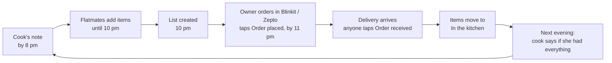

# Rasoi Ready: app documentation

**Smart Grocery Planner · MVP prototype**
Team B14, Section B · Software Product Management, ISB (Prof Chandrashekhar V) · November 2026
Dishali Jain · Mayur Sanjay Deshpande · Vaibhav Ravindra Gurjar · Sai Kiran · Rudraksh Gupta

> For flatmates who share a cook, Rasoi Ready puts tomorrow's ingredients in the kitchen before the cook
> arrives, with no more effort than a WhatsApp message.

---

## Contents

1. [What the app is for](#1-what-the-app-is-for)
2. [Who uses it](#2-who-uses-it)
3. [How it works: the evening in four milestones](#3-how-it-works-the-evening-in-four-milestones)
4. [Core ideas](#4-core-ideas)
5. [Every screen](#5-every-screen)
6. [Rules and edge cases](#6-rules-and-edge-cases)
7. [The prototype: three test journeys](#7-the-prototype-three-test-journeys)
8. [Design principles applied](#8-design-principles-applied)
9. [How the app maps to our decks](#9-how-the-app-maps-to-our-decks)
10. [Analytics and metrics](#10-analytics-and-metrics)
11. [Technical guide](#11-technical-guide)
12. [Limitations and next steps](#12-limitations-and-next-steps)
13. [How we got here: change history](#13-how-we-got-here-change-history)

---

## 1. What the app is for

In flats where 2 to 4 people share a hired cook, only the cook knows what is in the kitchen, and she finds
out what is missing when she is already at the stove. Nobody owns the ordering, so each flatmate assumes
someone else will order. The result: meals eaten out, a cook kept waiting, second orders minutes later,
and items bought twice.

Rasoi Ready moves "knowing what is needed" to **the evening before**, and gives the order **one named
owner**:

| Problem (from our interviews) | What the app does about it |
|---|---|
| **PR1** Missing stock found only when the cook arrives | The cook's evening note says what's running out, so the order is placed the night before |
| **PR2** Nobody owns the ordering | One owner each night; turns rotate on their own; only the owner orders |
| **PR3** Orders from memory are incomplete | One combined list, with quantities, for the whole flat |
| **PR4** Deciding what to cook every day | The cook names tomorrow's dish, or the app suggests one from the flat's usual dishes |

The app sits on top of Blinkit, Zepto and Instamart. **It never orders, pays or delivers.** The owner
places the order in their own app and tells the flat it's done.

---

## 2. Who uses it

| Person | Role in the app | What they do |
|---|---|---|
| **Tonight's owner** (e.g. Aditya) | A flatmate whose turn it is tonight | Places the order and confirms it arrived |
| **Other flatmates** (e.g. Rohan, Karan) | Flatmates not ordering tonight | Add what they need, see progress, can confirm delivery |
| **The cook** (e.g. Sunita didi) | The person who knows the kitchen | Sends one evening note: today, tomorrow's dish, what's running out |

Owner and flatmate are the same kind of account; who is "owner" changes every night. The cook has her own
simpler screen, in Hindi, Telugu or English, built on pictures so she can use it without reading.

---

## 3. How it works: the evening in four milestones

Every evening runs the same way. The four milestones are shown at the top of the Home screen and on the
cook's screen, and tick off as they happen.

| Time | Milestone | What happens | Who acts |
|---|---|---|---|
| by **8:00 pm** | **1 · Didi's note** | The cook says whether today had everything, tomorrow's dish, and what's running out | Cook |
| until 10 pm | (collecting) | Flatmates add anything else they need to the list | Any flatmate |
| **10:00 pm** | **2 · List created** | The list goes out to everyone. Tonight's owner sees a reminder that stays until they order | Automatic |
| by **11:00 pm** | **3 · Order placed** | The owner orders in their own app, then taps **Order placed**. Everyone sees it | Tonight's owner |
| ~20 min later, by **11:45 pm** | **4 · Order received** | When the delivery arrives, anyone in the flat taps **Order received**. The items move into *In the kitchen* | Any flatmate |



The next evening's note starts with "Did today have everything?", which closes the loop: it tells the
flat whether last night's order worked.

---

## 4. Core ideas

### One owner, rotating turns
- Each night has exactly one owner. Turns rotate through the flatmates who opted in ("I take a turn
  ordering").
- On the cook's day off the turn does not move.
- The owner can **hand over** tonight to another flatmate if they can't do it.
- Only the owner sees **Order now**, so nothing is bought twice. Only the owner gets the reminder.

### One list
- Items come from the cook's note and from any flatmate. The same item is never listed twice.
- After the order is placed, the list is closed. Anything added later goes on **tomorrow's** list.

### Quantities from dropdowns
Each item has a unit type, and quantity is picked from two dropdowns (amount, unit):

| Unit type | Units | Amounts | Examples |
|---|---|---|---|
| Solid | g / kg | 50, 100, 250, 500 g · 1–5 kg | onions, potatoes, paneer, atta, rice, dal |
| Liquid | ml / L | 50, 100, 250, 500 ml · 1–5 L | milk, oil |
| Countable | Nos | 1–12 | eggs, lemons, bread, coriander, spinach |
| Typed in by hand | any | any of the above | e.g. Maggi (defaults to Nos) |

25 ingredients are built in, each with a picture and names in English, Hindi and Telugu.

### In the kitchen
- The Groceries tab keeps a list of what is in the kitchen, with amount and arrival date.
- It updates itself: received orders move in, and items the cook says were missing today move out.
  Nobody has to count stock.
- Items that are on the list are tagged **On the list**. Anything else can be put on the list with
  **+ Order**.

### Tomorrow's dish
- The cook names tomorrow's dish in her note, from the flat's 10–15 usual dishes.
- If she doesn't, Home shows a **Decide tomorrow's dish** card with a suggestion: a usual dish not
  made this week. Any flatmate taps **Sounds good** or picks **Something else**.
- The card appears **only when a decision is needed**; otherwise the dish shows as one line in the main card.

### Splitting the cost
When placing the order, the owner can enter the bill. The app shows each flatmate's share and links to
Splitwise. The plan shown in the app is **₹149 a month per flat**, split between flatmates.

---

## 5. Every screen

### 5.1 Start: "Who are you tonight?"
- The first screen shows the app's promise and three people to choose from: **Aditya** (orders tonight),
  **Rohan** (flatmate), **Sunita didi** (cook).
- You live through the whole evening as that person and can't switch mid-way. Logging out brings you
  back here.
- **New here? Set up your own flat** starts the sign-up for a new user.

### 5.2 Sign in
- **Phone number:** filled in for the three sample people. New users type their number.
- **One-time code:** always fills itself in about 1.5 seconds, as SMS autofill does, for every user. The
  box can't be typed in; it turns green with "✓ Filled in from your SMS". Then tap **Verify**.
- **New users** then enter their name and choose **I live in the flat** or **I cook for a flat**
  (cooks also choose Hindi, Telugu or English).

### 5.3 Set up a flat (new flatmates)
- **Create a flat**, in four short steps:
  1. **Flat:** name and area.
  2. **Cook:** her name, phone (optional), language, and whether she comes once or twice a day.
  3. **Usual dishes:** pick 10–15 from 20 suggestions, or add your own.
  4. **Turns:** opt into the ordering turn, and choose the weekly staples-check day (atta, rice, oil, dal).
- You get a 6-letter **invite code** and buttons to invite flatmates and the cook on WhatsApp.
- **Join a flat:** enter the code, see the flat, choose whether to take a turn, and join.
- A cook who signs in with the number the flat saved for her is connected automatically; otherwise she
  joins with the code.

### 5.4 Flatmate app: four tabs

**🏠 Home: "Tomorrow's cooking"**
- **Simulate bar** (prototype only; see section 7).
- **Four milestones** with times.
- **One main card** that says the single thing to do now. It changes through the evening:

| When | Tonight's owner sees | Other flatmates see |
|---|---|---|
| Before 8 pm | "Sunita didi's note comes at 8:00 pm" + *Add something you noticed* | Same, plus "Nothing for you to do" |
| After the note, before 10 pm | "Sunita didi's note is in", the items so far, *Need anything else? Add it* | Same |
| 10 pm, not ordered | **Your turn to order** with the list and **Order now** (reminder stays until ordered) | "Aditya is ordering", list, nothing to do |
| Order placed | "Order placed · on its way", arriving from 20 min later | Same, with the arrival window |
| Delivery due | **Has it arrived?** + **✓ Order received** | Same |
| Received | 🎉 **Kitchen ready for tomorrow** (see below) | Same |
| No note after 8 pm | "Didi's note hasn't come": **Add what's low**, then *That's everything* | "Aditya will add what's low" |
| Cook's day off | "No cook tomorrow. Nothing to order tonight." | Same |

- **Didi's note card:** whether she had everything today, her voice note if she recorded one, and
  *We had to order extra today* (a same-day top-up, so the visit doesn't count as ready).
- **Can you order tonight?** Shown to a flatmate when tonight's owner asks them to take over:
  *Yes, I'll order* or *Not tonight*.
- **Quick check:** on two days a week, a flatmate who isn't tonight's owner is asked "Did didi have
  everything today?" (the spot check that cross-checks the cook's own answer).
- **Decide tomorrow's dish:** only when she didn't name one.
- **Kitchen ready for tomorrow:** the closing card, with confetti, a recap of the evening (note, list,
  who ordered on which app, who received it), days this week she had everything, your share of the bill,
  and who orders tomorrow.

**🧺 Groceries**
- **To order** (top): a status label (Needed → Ordered → Received), one line on where things stand,
  and the list with quantity dropdowns, who added each item, and ✕ to remove. **Order now** for the owner
  at 10 pm. *Copy list*. Items for *tomorrow's order* show underneath once tonight's is placed.
- **In the kitchen** (bottom): everything available, with amount and arrival ("Arrived today", "Since
  yesterday", "Since Tue, 24 Nov"), **On the list** tags, **+ Order** buttons, and "Just arrived"
  highlights after delivery. Tap an item to report it **Bought twice** or (vegetables) **Not fresh**.
- **+ Add item** opens the add sheet.

**🍛 Dishes**
- The flat's usual dishes (add or remove), and what was cooked this week with who decided it
  (the cook, a suggestion, or the flat).

**👥 Flat**
- **Turns:** tonight's owner and the next three, *Can't tonight? Hand over* (owner only: asks another
  flatmate, and the turn moves only when they accept), and *Who's ordered this month* (orders per person
  against a fair-share line, plus the *I take a turn* switch).
- **Flatmates** and the invite code (copy or WhatsApp).
- **Cook:** name, language, visits a day, whether she's on the app, *Send her the link*, staples day.
- **Plan:** ₹149 a month per flat, split. *See plan* opens the day-21 pre-pay question: *We'd pre-pay
  ₹149*, *Ask later* or *No thanks*, with "split across all flatmates", "the dish suggestions are a
  reason" and an optional reason. No payment is taken in the app.
- **Settings:** *Mute reminders* and *Leave this flat* (two taps).
- **How Rasoi Ready works**, and **Log out**.

**🔔 Notifications** (bell, top right): the note arrived, the list created, the owner's reminder (owner
only), order placed, order received.

### 5.5 Add item sheet
- A search box and a grid of ingredient pictures. Tap to add; the item appears at the top with its
  amount and unit dropdowns. Add anything else by typing its name.
- Items already on the list are marked **on list**. After tonight's order, the sheet adds to tomorrow's list.

### 5.6 Order sheet (tonight's owner)
1. **Copy the list:** a paste-ready list, one item and quantity per line.
2. **Order in your app:** buttons for Blinkit, Zepto and Instamart.
3. **Tell the flat it's placed:** choose the app, enter the bill (optional) to see each share, and tap
   **✓ Order placed**.

The sheet then confirms "Done! Everyone in Quad 3 can see the order is placed… arrives in about 20
minutes", with *Add it on Splitwise*.

### 5.7 Cook app (one screen)
- **Language switch** at the top: हिं / తె / EN. All her questions and labels change.
- **Simulate bar** and **four milestones** (labels in her language).
- **Her three questions,** all by tapping:
  1. **Did you have everything today?** Big 👍 / 👎. If 👎, she taps what was missing, anything that
     wasn't fresh 🥀, and *We had to order extra today*. If a dish was planned for today, she also answers
     **Did you cook *[dish]*?**
  2. **What will you make tomorrow?** The flat's usual dishes, with the suggestion marked ⭐, or *Not decided*.
  3. **What is running out?** Picture tiles; on the flat's staples day, atta, rice, oil and dal are added.
     She can also **record a voice note** (up to 60 seconds).
- **Not coming tomorrow:** marks her day off (nobody orders, turns don't move).
- **Send to the flat.** Then she sees *Sent. Thank you!*, tomorrow's list as pictures, and the order
  status (*not ordered yet* → *ordered by Aditya*). When the flat receives the order, her screen ends on
  **"कल के लिए सब तैयार!"** (All set for tomorrow!). She can *Change my note*.

---

## 6. Rules and edge cases

| Situation | What the app does |
|---|---|
| Cook hasn't sent her note by 8 pm | Only tonight's owner is asked "If tomorrow is *X*, what's low?". They add items and tap *That's everything* |
| Cook not coming tomorrow | Nobody orders; the turn doesn't move to the next person |
| Owner can't order tonight | Hand over tonight to another flatmate (Flat tab) |
| Two people add the same item | It appears once |
| Someone adds an item after the order | It goes on tomorrow's list, so nothing is bought twice |
| Reminder | Only tonight's owner, from 10 pm, until they tap Order placed. Nobody else is reminded |
| Order received | Opens 20 minutes after the order is placed (delivery time). Any flatmate can tap it |
| Cook says something was missing today | It leaves *In the kitchen* |
| Order received | Tonight's items move into *In the kitchen* (replacing older entries of the same item) |
| Dish not named by the cook | Flatmates see *Decide tomorrow's dish* with a suggestion from usual dishes not made this week |
| Staples day | The cook's question 3 also shows atta, rice, oil and dal |

---

## 7. The prototype: three test journeys

The prototype has no backend, so the evening is **simulated** on one device.

### Simulate bar
- **▶ Simulate** starts the clock at **7:30 pm** and runs to **midnight**. Each real second moves the
  clock 10 minutes (about 6 seconds per hour, ~27 seconds for the whole evening). Change the speed with
  `SIM.minutesPerSecond` in `src/lib/logic.ts`.
- **Pause / Resume** and **Restart** (back to 7:30 pm, with tonight's list, its events and the kitchen
  put back as they were).
- **Next day ›** replaces the main button at midnight. It moves to the next evening at 7:30 pm: turns
  rotate (after Aditya comes Karan, then Rohan), and the cook's next note answers "did today have
  everything?" about the order just placed. Restart is still there to run tonight again.
- **📊** opens the team's **Metrics** view (section 10).

### What happens on its own
Everyone you are **not** playing acts automatically:

| Journey | You do | Happens on its own |
|---|---|---|
| **Aditya · orders tonight** | Add items (optional) · pick tomorrow's dish · at 10 pm **Order now → Order placed** · ~20 min later **Order received** | Didi's note at 8 pm · list at 10 pm with the reminder |
| **Rohan · flatmate** | Add items before 10 pm (optional) · pick tomorrow's dish · **Order received** once it appears at 11:20 pm | Didi's note at 8 pm · list at 10 pm · **Aditya orders at 11:00 pm** · if Rohan hasn't, **Aditya receives it at 11:45 pm** |
| **Sunita didi · cook** | At 8 pm the clock **waits for her**: answer the 3 questions and send | List at 10 pm · Aditya orders at 11:00 pm · the flat receives it at 11:30 pm |

In the flatmate journeys, Didi's automatic note leaves the dish open, so testers see the dish decision.

> At 10 minutes per second, Rohan's *Order received* window (11:20 to 11:45 pm) lasts about 3 seconds.
> Pause the clock at 11:20 if a tester needs more time.

### Sample data: flat "Quad 3"
- Flatmates **Aditya, Karan, Rohan** (turn order) and cook **Sunita didi** (Hindi), invite code `QUAD03`.
- 12 usual dishes, two weeks of history (orders, one skipped day, two "missing" visits), and 11 items in
  the kitchen (atta, rice, dal, oil, onions, potatoes, tomatoes, garlic, green chillies, milk, eggs).
- Aditya is always tonight's owner when a journey starts. After **Next day**, the turn moves on and
  the label in the Simulate bar follows it ("Aditya · flatmate", "Karan orders tonight").
- The two weeks of history are also stored as analytics events, so the Metrics view has week-on-week
  numbers from the start.

A one-page-per-person test guide is in `Rasoi-Ready-Test-Guide.pdf`.

---

## 8. Design principles applied

From [Design principles for reducing cognitive load](https://lawsofux.com/articles/2015/design-principles-for-reducing-cognitive-load/):

| Principle | In the app |
|---|---|
| Avoid unnecessary elements | One main card with the one thing to do now; the dish card only when needed; turns moved to Flat; four tabs |
| Use common patterns | Bottom tab bar, phone + one-time-code sign-in with autofill, notification bell, progress steps |
| Eliminate unnecessary tasks | Code fills itself; default quantities; dish suggestions; only the owner is ever asked to order |
| Minimise choices | At most one primary button per state; less-used details open on request |
| Show choices as a group | All ingredients and all usual dishes visible at once |
| Readable text | 15–16 px body text, high contrast, plain sentences |
| Icons with labels | Every icon has a word next to it (tabs, items, persona cards, buttons) |

From the [peak-end rule](https://lawsofux.com/peak-end-rule/):

- **Peak:** placing the order is quick and confirmed at once ("Done! Everyone in Quad 3 can see the order").
- **End:** every journey ends on a celebratory screen with a recap of the evening; the cook's ends in her
  own language.
- **No negative peaks:** reminders and missed-note messages are polite, not alarms.

Other choices:
- **Mobile-first**, shown in a phone frame on a laptop and full screen on a phone.
- **No zoom:** pinch, double-tap, Ctrl/⌘ + scroll and Ctrl/⌘ +/− are blocked; form fields are 16 px so
  iPhones don't zoom in.
- **The cook's side needs no reading or typing:** pictures, big buttons, voice, her language.

---

## 9. How the app maps to our decks

| Deck item | Where it lives in the app |
|---|---|
| B1 Cook sends tomorrow's dish and the gaps | Cook app, three questions + voice note |
| B2 One list with quantities | Groceries · To order (list created at 10 pm) |
| B3 One owner, one reminder, "ordered" | Turns, owner-only Order now, reminder, Order placed |
| B4 Cook reports each visit | "Did you have everything today?" and "Did you cook [dish]?" in her note |
| B5 All events logged per flat per day | The 33 tracked events and the Metrics view (section 10) |
| B6 Dish suggestion from usual dishes | Decide tomorrow's dish card; ⭐ in the cook's list |
| B7 Weekly staples check | Staples day adds atta, rice, oil, dal to her question 3 |
| B8 Hindi and Telugu | Cook app language switch |
| B9 Rs 149 pre-payment | Plan card (₹149 a month per flat, split) |
| B12 Fee split per flatmate | Bill split per head + Splitwise link |
| B14 Bill to Splitwise; "who ordered" summary | Splitwise link; *Who's ordered this month* |
| North Star: ready cook visits | "Days this week she had everything" on the closing card |

**Where the app departs from the decks** (agreed during the build):
- The decks planned a concierge MVP inside WhatsApp with **no app or login**. This prototype is a
  standalone app with phone sign-in; WhatsApp is still used for invites and sharing.
- The decks listed **pantry tracking** as a non-goal. *In the kitchen* was added on request; it fills
  itself from received orders and the cook's answers, so nobody counts stock.
- The list goes out at **10 pm** (the decks said 9 pm) and the owner's reminder **stays until the order is
  placed** (the decks said one nudge at 10 pm).
- **Order received** is a fourth milestone tapped by a flatmate; the decks measured the outcome through the
  cook's next-visit answer, which the app still asks.

---

## 10. Analytics and metrics

The app sends the events in the team's **Rasoi Ready analytics and event tracking spec**, so the North
Star, its three inputs, the GAME goals and the guardrails are computed from stored events for every
flat-evening.

### How events are recorded
- `track()` in `src/lib/analytics.ts` adds the **common properties** to every event: `event_id`,
  `event_name`, `occurred_at` (UTC), `evening_date` (IST), `flat_id`, `person_id`, `role`,
  `is_owner_tonight`, `ui_language`, `app_version`, `platform`, `is_simulated`.
- **People are a hash:** `person_id` is SHA-256 of the phone number plus an app-wide salt. No names,
  phone numbers, invite codes, voice audio or transcripts are stored in events; typed item names are sent
  as `custom`.
- **State events fire where the change happens,** in `src/lib/logic.ts` (note, list, order, delivery,
  hand-over, day off). So real taps and the people the Simulate bar plays send exactly the same events.
- **Test data is flagged, not deleted:** everything from the Simulate clock or the sample flat Quad 3 has
  `is_simulated = true`.
- Events are an **append-only log** kept with the app's data on the device. Restart takes the restarted
  evening's events back out, because it re-runs the same evening.

### The 33 events

| Group | Events |
|---|---|
| Setup (7) | `user_signed_up`, `flat_created`, `flat_joined`, `cook_joined`, `rotation_changed`, `usual_dishes_shared`, `invite_sent` |
| Evening (17) | `ask_sent` (cook prompt, owner reminder, owner fallback, hand-over request), `cook_note_received`, `cook_visit_checked`, `cook_day_off_marked`, `item_added` (cook note, sheet, kitchen re-order, owner fallback, staples day), `item_add_blocked`, `item_changed`, `owner_fallback_completed`, `dish_suggested`, `dish_decided`, `list_posted`, `turn_handed_over`, `order_started`, `list_copied`, `order_confirmed`, `order_received`, `evening_recap_viewed` |
| Outcome, guardrail, money (7) | `top_up_reported`, `duplicate_reported`, `freshness_reported`, `flatmate_spot_checked`, `flat_muted_or_left`, `plan_viewed`, `prepayment_answered` |
| Effort (2) | `task_completed`, `task_abandoned` for sign in, add item, re-order from the kitchen, place order, confirm delivery, cook's note, hand over, set up a flat |

**New buttons added for the spec:** planned dish cooked, *We had to order extra today*, *Bought twice*,
*Not fresh*, the flatmate spot check, the pre-pay question, accepting a hand-over, *Mute reminders* and
*Leave this flat*.

**Effort counting:** taps on controls and typed characters are counted from a task's first tap to the
event that ends it. Autofill and the self-filling code count as 0. In a browser run, the counts matched
the prototype bars: sign in 3 taps, add an item 4, place the order 3 (+3 characters for the bill),
confirm delivery 1.

### The Metrics view (team only)
Open it with **📊** on the Simulate bar. Flatmates and cooks never see it. Per flat and per week
(Monday to Sunday, IST), with the count beside every percentage:

- **North Star:** ready cook visits this week, ready share, days with no note, last week for comparison.
- **Inputs:** active flat, note coverage (target 5 of 7), order-through (pass rule 70%), came back.
- **G1:** first note within 3 days of setup; "something missing" visits against week 1.
- **G2:** flatmates in the rotation, owner orders after one reminder, order concentration (last 14 days,
  flats of 3+), duplicate buys, fee split.
- **G3:** usual-dish list, dish named by 8 pm, suggestion accepted, planned dish cooked, dish as a reason
  to pay.
- **Guardrails:** most asks to one person in a day (stop at 2), opt-outs, duplicate or spoiled items,
  freshness complaints.
- **Money and effort:** pre-pay rate at ₹149, time from note to list and to order, median taps per task
  against its bar.
- **Flat evenings:** the derived `flat_evening` table, one row per evening.
- **Event log:** every event with its properties, with *Copy JSON*, *Download JSON* and *Download CSV*.

Each metric shows its target, an on-target or below-target label, and the spec's "if it misses" action.
*Include test data* is on by default, because every event in the prototype is simulated; turning it off
shows what a real pilot would count (nothing yet).

### Where the prototype differs from the spec
- **No backend yet.** Events stay on the device; the spec's batching to a server, `received_at`, and
  moving `list_posted` and the 10 pm reminder to the server come with the backend (spec steps 1 and 5).
- **Hand-over:** the `hand_over` task ends when the request is sent; `turn_handed_over` fires when the
  other flatmate accepts or declines. In the simulation, someone you aren't playing accepts after 10
  minutes.
- **Spot-check days** are picked from the flat and week, two a week; on other days the card doesn't show.
- **The pre-pay question** is available whenever *See plan* is opened, rather than only on day 21.

---

## 11. Technical guide

### Stack
Vite 5, React 18, TypeScript 5, Vitest. No UI library, no backend. Static site, deployable on Vercel.

### Run and deploy
```bash
npm install
npm run dev      # http://localhost:5173
npm test         # 21 tests: turns, list, quantities, milestones, journeys, kitchen, events per role, metrics
npm run build    # output in dist/
```
Vercel: import the GitHub repo; it is detected as Vite (`vercel.json`: `npm run build`, output `dist`).
No environment variables. Pushing to `main` redeploys.

### Project structure
```
src/
  main.tsx              app entry; disables zoom
  App.tsx               start/sign-in → flat set-up → cook app or flatmate tabs
  styles.css            all styles
  components/
    ui.tsx              sheet, avatar, copy button, voice note + recorder, quantity dropdowns
    Sim.tsx             Simulate bar and the four milestones
  screens/
    Auth.tsx            "Who are you tonight?", phone, auto-filled code, new-user profile
    FlatStart.tsx       create a flat (4 steps) or join with a code
    Home.tsx            Tomorrow's cooking: main card, Didi's note, dish decision, closing card
    Groceries.tsx       To order + In the kitchen
    Tabs.tsx            Dishes, Flat (with Turns)
    Sheets.tsx          add item sheet, order sheet
    Cook.tsx            the cook's one-screen app
    Metrics.tsx         the team's Metrics view (North Star, inputs, GAME, guardrails, events)
  lib/
    analytics.ts        track(), common properties, hashed person ids, effort tasks
    metrics.ts          metric formulas and the flat_evening table, from events
    types.ts            data model
    logic.ts            turns, the evening, list, milestones, simulation, notifications, kitchen
    store.tsx           state, saving to the browser, simulation clock
    seed.ts             sample flat "Quad 3" and the three personas
    catalogue.ts        25 ingredients: picture, English/Hindi/Telugu name, unit type, default amount
    qty.ts              units and amounts for the dropdowns
    i18n.ts             the cook's wording in English, Hindi and Telugu
    noZoom.ts           blocks browser zoom
    logic.test.ts       app logic tests
    analytics.test.ts   one full evening per role sends the expected events in order; metrics
```

### Data model (simplified)
- **User:** name, phone, role (flatmate or cook), language, flat.
- **Flat:** name, area, invite code, flatmates, turn order, cook details, usual dishes, staples day,
  **pantry** (items in the kitchen).
- **Evening** (one per flat per date): owner and turn position, the cook's note, flatmates' additions,
  quantity edits, removals, tomorrow's dish (and how it was decided), order placed (by, time, app, bill),
  order received (by, time), day off, a pending hand-over, and a snapshot of the kitchen at the start
  (for Restart).
- **Events:** the append-only analytics log (section 10).

Data is saved in the browser's local storage (key `rasoi-ready:app:v6`). **Reset** happens by logging in
as a persona (each journey starts fresh) or clearing site data.

### Settings you can change (`src/lib/logic.ts`)
| Setting | Value | Meaning |
|---|---|---|
| `SIM.start` / `SIM.end` | 19:30 / 24:00 | Simulation window |
| `SIM.minutesPerSecond` | 10 | Clock speed (use 1, 3, 5, 10 or 15 so times land neatly) |
| `DEADLINES.note` | 20:00 | Didi's note due |
| `DEADLINES.list` | 22:00 | List created, owner reminder starts |
| `AUTO.orderAt` | 23:00 | When the owner orders automatically (Rohan's and Didi's journeys) |
| `AUTO.deliveryMins` | 20 | Minutes from order placed to "Order received" opening |
| `AUTO.receiveByFlatmateView` | 23:45 | Aditya receives it if Rohan hasn't |
| `AUTO.receiveInCookView` | 23:30 | The flat receives it in Didi's journey |

---

## 12. Limitations and next steps

**Prototype limits**
- No backend: data lives in one browser, so two phones don't share a flat yet.
- Sign-in codes aren't really sent; they fill themselves.
- Voice notes are recorded and played back, but not transcribed.
- Choosing a dish doesn't add its ingredients to the list (recipes were a non-goal).

**Next steps**
1. A backend for accounts and shared flat data (e.g. Supabase or Firebase), real SMS codes, and an
   events table the app sends its analytics to (spec steps 1, 2 and 5).
2. Real notifications (push or WhatsApp) for the note, the list and the owner's reminder.
3. Voice-to-list in Hindi, Telugu and English (roadmap B11).
4. One-tap cart into Blinkit or Zepto, after a feasibility check (roadmap B13).
5. Optional "this dish usually needs…" hints after a dish is chosen, never added automatically.

---

## 13. How we got here: change history

| Version | What changed |
|---|---|
| 1 · Concierge console | A back-office dashboard for running the 3-week pilot by hand (later replaced: the team wanted the user app) |
| 2 · User app | Phone sign-in, create or join a flat, flatmate tabs, the cook's picture-based screen in Hindi/Telugu/English |
| 3 · Quantities and Simulate | g/kg, ml/L and Nos dropdowns; Simulate clock; four milestones; Order placed and Order received; three views; Didi's journey pauses at 8 pm |
| 4 · No zoom | Browser zoom blocked on phones and laptops |
| 5 · Fixed journeys and redesign | Pick one person at the start; others act on their own (Aditya orders at 11 pm; delivery window 11:20–11:45); cognitive-load and peak-end redesign; closing celebration |
| 6 · Groceries and Home | *To order* + *In the kitchen*; Tonight renamed Home ("Tomorrow's cooking"); dish card only when needed; Turns moved to Flat; code always auto-fills; "Roommate" → "Flatmate" |
| 7 · Faster clock | `minutesPerSecond` raised from 3 to 10 (about 6 seconds per simulated hour) |
| 8 · Analytics and Next day | The 33 events from the tracking spec, effort tracking, the new buttons the spec needs, a team Metrics view computed from events, and **Next day** after midnight |

Also produced: a **Whiteboard** user-flow diagram and a **three-page test guide PDF** (one page per person).
